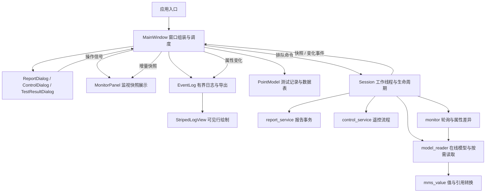

# Qt Client Lite：结构与维护规范

适用范围：独立的 `native-lite` 应用。既有 Electron 客户端、Service Studio 不属于本次重构范围。

## 问题与调整

原先主窗口同时构建监视列表、处理表单字段、发送协议命令；`session.cpp` 混合连接生命周期、模型遍历和 MMS 格式转换。大量同一行多条语句使审查和错误定位困难。

0.1.3 按职责拆分，并建立编译边界：

`lite_protocol` 静态目标依赖 Qt Core 与 libiec61850，不链接 Widgets；`lite_core` 是界面层，依赖 Widgets 与协议层。正式程序与集成测试链接相同的界面目标，避免两套源文件清单漂移。这是单进程、单通信工作线程架构，没有新增服务或运行库。

## 数据与线程规则

- Session 拥有连接、类型缓存、报告/遥控状态和轮询定时器；所有同步 MMS 调用只在工作线程执行。
- 协议回调只能排队通知，不在接收线程里同步调用协议 API 或触碰界面。
- 参数弹窗不读取 MainWindow 的私有状态。报告弹窗接收数据集列表，通过 `applyRequested` 交回参数；遥控弹窗通过 `commandRequested` 交回操作，并接收完成/错误反馈。主窗口统一处理忙碌状态。
- TestResultDialog 接收 PointModel 和持久索引，表单不直接写注册表；模型负责验证和保存，切换数据集使索引失效时拒绝保存。
- MonitorPanel 不连接 IED，也不请求额外属性。后台成功采样将同一份 `rows/attributes/receivedAt` 快照送往界面并用于日志比较。
- 监视项和属性项按引用增量更新，保留选中与展开状态。读取失败不覆盖成功值；状态提示数据可能过期，最近成功读取时间保持不变。恢复后正常更新，移除/断开清理相应行。
- 日志最多 3000 条，批量淘汰旧记录；StripedLogView 只为可见文本块设置整行底色，不随累计条数增加每帧绘制量。过滤后按可见日志序号重新交替，保持文本复制和 CSV 导出能力。

## 代码规范

`.clang-format` 统一 4 空格缩进、110 列宽、指针声明和括号样式，拆开多语句长行。运行 `tools/check-format.ps1` 检查，使用 `-Fix` 自动整理；提交前执行格式检查、构建与相关集成测试。不格式化第三方库，不把生成文件纳入维护。

新增功能先决定归属：网络事务进入协议模块，表单进入独立 Widget/Dialog，窗口只负责组装和路由。禁止把新协议逻辑、导出编码或字段校验继续塞入窗口构造函数。优先复用已读取的数据，不增加重复轮询；保留对象数、属性数与日志量上限。

当前仍使用 QVariantMap 作为内部命令与快照载体，Session 仍统一拥有协议状态，以保持串行调用与连接生命周期一致。后续增加复杂功能时可引入具名 DTO 与服务接口；本轮没有为少量字段引入插件框架或多级抽象。

## 验证

真实本机 MMS 服务联调覆盖在线模型、数据集、报告参数、GI、Direct/SBO 遥控、监视变化、测试记录和各独立弹窗。新增快照生命周期检查覆盖失败保值、恢复、清空及选中/展开保持；日志检查覆盖筛选、交替整行底色、有界缓存和 CSV。

监视是轮询快照，不保证捕获两次采样之间的所有变化；每秒最多读取 4 个对象、最多监视 64 个对象。Win7 SP1 x64 是兼容目标，目前尚无真实 Win7 / 4 GB 机器验收结果。
