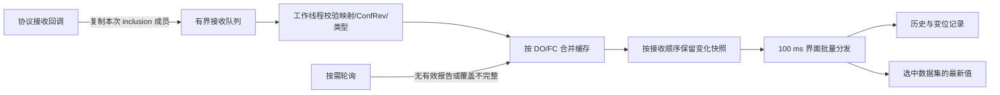

# 0.1.6 后台报告与连接初始化

## 行为变化

旧版报告回调只通知界面刷新选中的数据集，合并通知可能丢掉中间变化。新版连接时检查已启用 RCB 并安装接收器；用户应用报告使能时先准备数据集成员和必要基线，再使能与 GI。不会自动使能全部 RCB。读取到 RptEna=true 不代表该控制块属于本连接，只有实际收到该流的有效报告后才用报告替代相应轮询。

报告对象生命周期由协议库管理。依据 [libiec61850 报告接口文档](https://support.mz-automation.de/doc/libiec61850/c/latest/group__IEC61850__CLIENT__REPORTS.html)，回调内复制本次 inclusion 成员值，随后排队到工作线程。未包含成员保持最近已知值，不误当零值，不用后续 Read 的结果替代本次报告。

- 已收到有效报告的数据集：前台定时请求读取缓存，不重复读设备。
- 已加入监视且全部保留 ST/MX 属性有有效报告覆盖：跳过该对象轮询，报告变化仍产生属性变化日志与监视表更新。
- 无报告或只覆盖部分属性：保留按需轮询。选中其他页不会让未监视、无报告的对象突然开始全量采集。
- 初始化基线明确标记来源；正常报告来源为“MMS 报告”。不同连接端点的数据在批次中携带设备标识，不因 UI 已切换设备而记错历史归属。
- dU 为连接内描述缓存；设备时标保持 q/t 对应属性来源，不以电脑时间替代。

## 边界与异常

最多接入 64 个报告控制块、每个最多 4096 成员，支持本轻量版范围内 ST/MX 成员；非 ST/MX 或无法准备基线时记录原因并保留按需读取。报告回调队列最多 128 份，每份复制值的估算编码总量最多 64 KiB；界面待交付变化最多 8192 行。达到限制会明确提示历史存在缺口并停用本地报告覆盖状态，恢复已有的按需轮询，不悄悄声称完整。内存中对象缓存最多 32768 个 DO/FC 条目，历史仍为 5000 条。

RCB ConfRev 改变、bufOvfl、成员长度/类型不匹配时不继续沿旧映射更新。需要重新读取并应用报告参数建立映射。取消本地覆盖不等于写 RptEna=false，不擅自修改设备配置。后台不提供自动重连、BRCB EntryID 持久化重放，也不承诺完整 SOE；分段报告按收到的 inclusion 分段更新最近已知值，并非跨段原子快照。设备外部停用报告时，可重新读取 RCB 以更新本地覆盖状态。

## 连接日志和进度

代码中没有自动连接/断开重试循环。本次修正两条会造成体验混乱的路径：

1. 连接状态回调绑定创建时的不可变会话代次和原始连接句柄。销毁/替换旧连接产生的通知，不能影响新会话；主动断开不会又被记录成意外断连。
2. MMS 关联正常但在线模型读取失败时，保留连接并提示刷新模型重试；单个 LD 目录失败可继续其他设备目录。只有实际关联失败或已断开才清理连接。初始化填充数据集列表时阻断选择信号，防止列表重建触发多余请求。

进度显示校验参数、TCP/COTP/ACSE/MMS 关联、逻辑设备/节点目录、已启用报告检查、报告基线对象数量、就绪。百分比表示任务阶段而非精确耗时；同步请求在工作线程执行，窗口继续响应。没有自动猜测、轮换协议参数或循环重连。

原现场未提供反复断连的完整新日志，因此不能断言现场所有断连都来自上述客户端路径；若设备真实关闭 TCP，软件仍会如实记录。

## 验证

真实 loopback Service Studio 联调：三次替换连接无误断连通知；进度完成至 100；GI 建立报告缓存；切到其他数据集仍保留连续 true/false 报告；停用后恢复按需读取；动态创建真实属性级数据集（stVal/q/t）验证部分成员合并、品质保留及缓存读取。窗口测试停留在线模型页并选中 Measurements，操作 Events 对象后验证底部出现来源为 MMS 报告的变位记录。

测试只访问独立本机服务，不访问用户现场 IED。真实 MMS-Lite 设备以及 Win7/4GB 硬件仍需现场复测。
