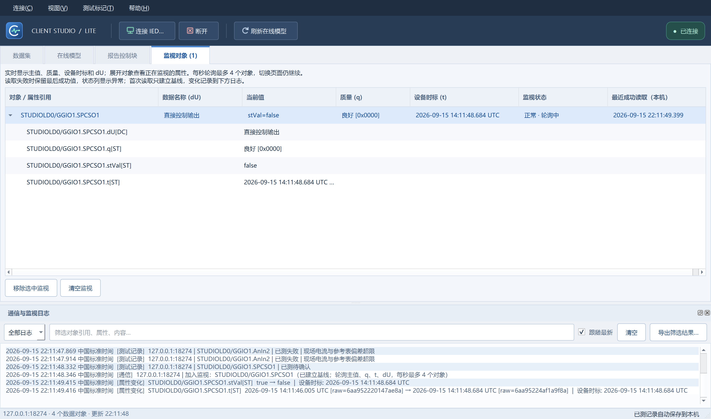

# 0.1.3 验证记录

- Qt 5.15.2 / MinGW 8.1 x64，开发机 Windows 环境。
- QtTest：9 passed、0 failed、0 skipped（含初始化/清理），8222 ms。
- 两万个数据表对象：加载 50 ms，同引用更新 15 ms；仅为开发机一次测试结果。
- 真实联调：仅使用自有 127.0.0.1:18274 Service Studio 测试服务。测试执行遥控让 SPCSO1 从 true 变为 false，断言监视主行与日志更新，选中/展开状态不丢失。
- 快照单元验证：值、名称与属性展示；失败保值与过期提示；恢复正常、清空列表。
- 日志验证：类别过滤后背景重新交替、整行背景标识、CSV 转义、3000 条容量上限。运行截图确认背景延伸到文本右侧空白。
- 重构回归：在线模型、报告设置/GI、Direct 与 SBO 控制、测试结果与失败原因对话框继续通过。
- 28 个自有 C++ 源码/头文件通过 clang-format 检查。
- 便携目录在去除 Qt/编译器 PATH 后启动成功，加载包内 DLL；首次输入空闲 370 ms。此为断开连接的开发机启动抽样，不是 Win7/4GB 验收。

代码职责和维护规范见 [架构说明](ARCHITECTURE.md)。
