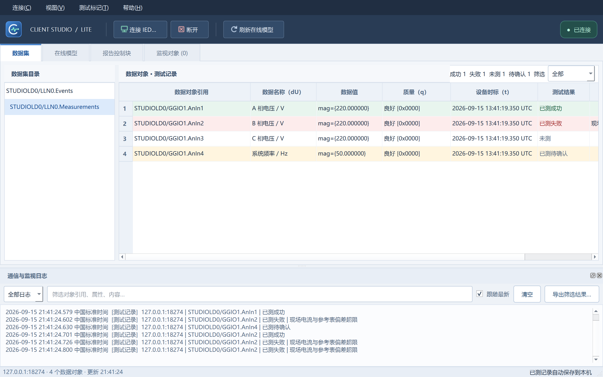
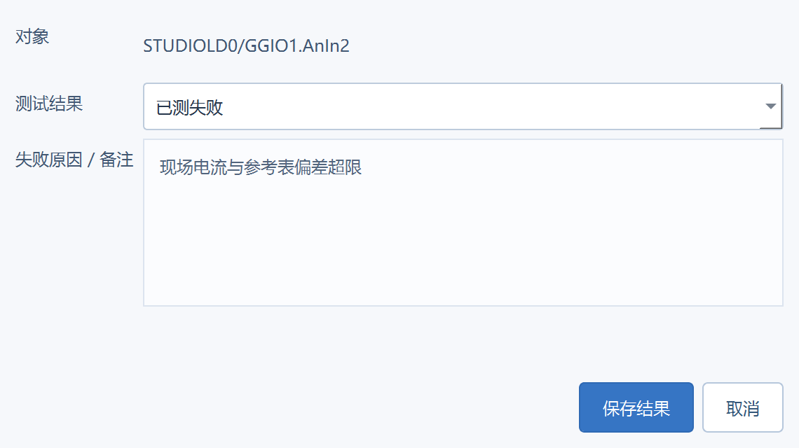
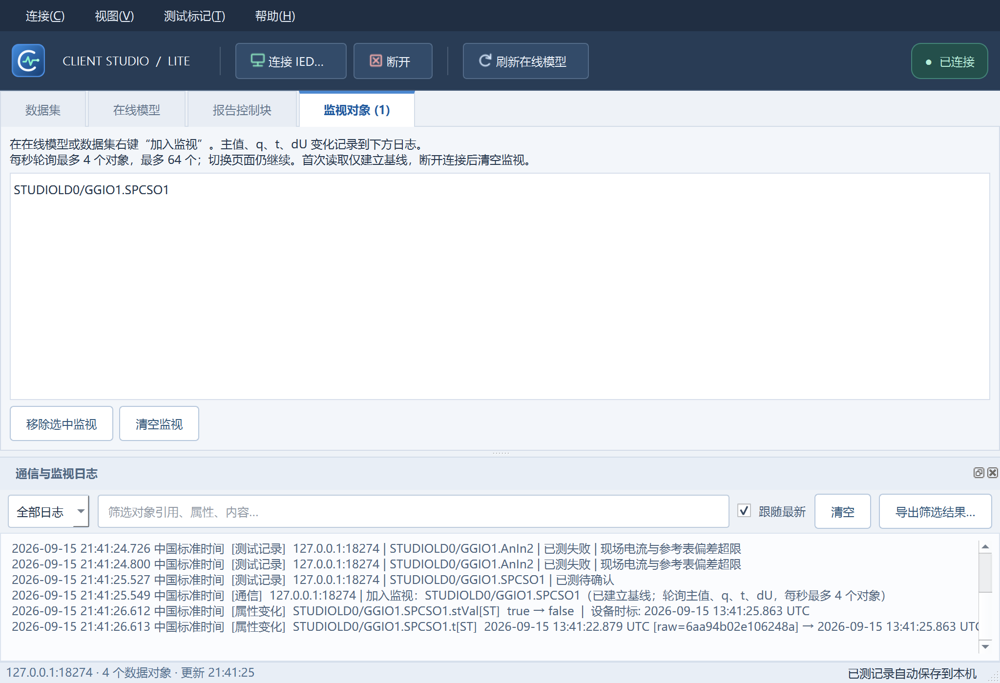

# 0.1.2 监视日志与测试结果

## 测试结果

在“数据对象 · 测试记录”标题右侧选择全部、未测、已测（全部）、已测成功、已测失败或已测待确认。旁边的数量是当前整个数据集的统计。

右键行可直接标记成功、标记失败、编辑结果与原因、重置为未测；也可双击“测试结果”或“失败原因 / 备注”列。失败原因必须填写，可保存最多 2000 字；成功可以填写备注。记录保存最新状态、原因/备注和 UTC 操作时间，按设备地址/端口/数据集/对象隔离。取消对话框不保存，清除测试结果会同时清除原因。

绿色：已测成功。红色：已测失败。白/浅灰：未测。淡黄色：旧版本仅勾选已测、尚未确认结果。旧记录不会自动变成成功。

## 监视与日志

在在线模型或数据集中右键对象，选择“加入监视”。可在“监视对象”页移除选中对象或清空列表。切换数据集、切换页或打开对话框不会停止采样。

监视轻量版保留属性：主值的叶属性（例如 `AnIn1.mag.f[MX]`）、品质 q、设备时标 t、名称 dU。首次读取建立基线；后续比较记录属性引用、旧值→新值、设备时标和电脑记录时间。浮点比较采用足够精度的文本，t 同时保留原始时间字节以识别亚毫秒/时间品质变化。

下方日志支持类别、关键词筛选、跟随最新、清空、将当前筛选导出 UTF-8 CSV。记录在内存中最多保留 3000 条，超出后批量移除最旧 500 条；退出前按需导出。导出列包含记录时间、类别、对象、属性、旧值、新值、设备时标、消息。

为低配置机器控制开销，每秒最多轮询 4 个对象、最多监视 64 个对象、每对象最多 256 个保留属性。网络耗时会拉长整轮间隔；轮询不是 SOE 录波，不能保证捕获两次采样间的快速跳变。读取失败不更新基线；非预期断连暂停监视，主动断开/重连清空列表。

## 应用图标

字母 C 与实时波形组成图标，内置 16/24/32/48/64/128/256 像素 Windows ICO。已用于 EXE 资源、窗口图标及工具栏。编辑源文件为 `src/icons/app.svg`，对应 PNG/ICO 一并保留，运行时不增加 SVG 模块。

## 验证

在独立本地 Service Studio 服务上验证模型/数据集读取、报告参数与 GI、直接控制、SBO 增强控制、监视基线、状态变化旧值/新值、移除监视后停止记录、跨页面持续监视。Qt UI 测试覆盖行颜色、失败必填、筛选后的右键操作映射、失败原因持久化、设备隔离、旧时间戳记录兼容、日志过滤/有界存储/CSV 导出。现有 Win7 实机验收限制不变。
