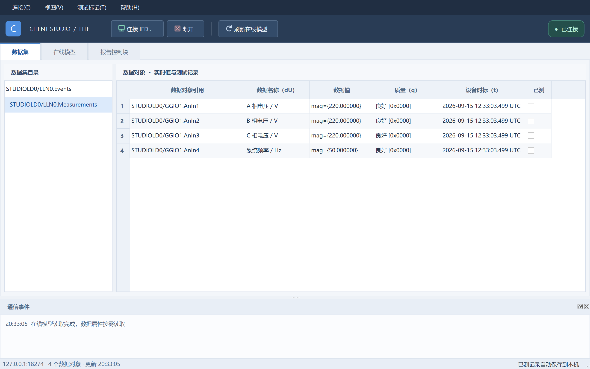
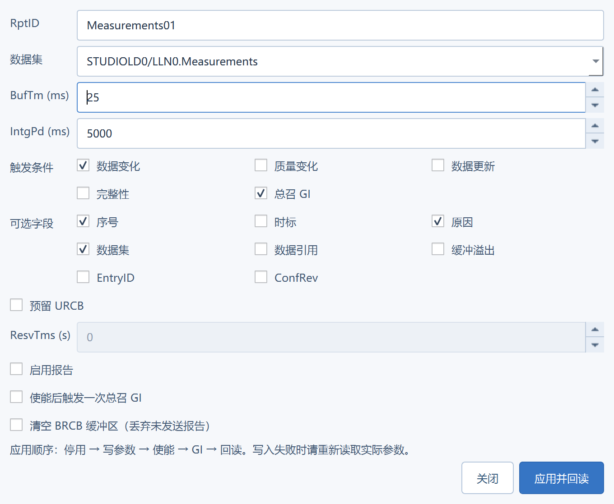
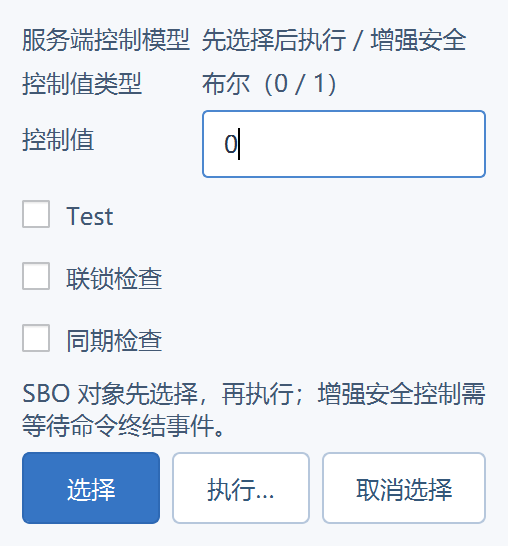

# 0.1.1 原生界面样式

使用与 Service Studio 呼应的深蓝工具栏与浅色数据区，统一菜单、按钮、标签页、表头、选中行、数据集目录、状态栏和原生弹窗。手工绘制小图标及箭头均随程序内置，不依赖网络或浏览器。

新样式在 `src/studio_style.cpp` 集中管理，使用 Qt Fusion 绘制。报告参数的“应用并回读”为主按钮，关闭为次按钮；断连/已连接通过文字与颜色同时提示。窄屏支持表格和目录横向滚动；完整内容仍可通过工具提示查看。

验证：真实 Service Studio MMS 联调与现有 QtTest 回归 7 passed、0 failed、0 skipped；检查了 1280×800、1024×700 逻辑窗口尺寸、报告参数和遥控弹窗。2 万行模型更新本机约 17 ms，此数值不包含网络与整表绘制。

