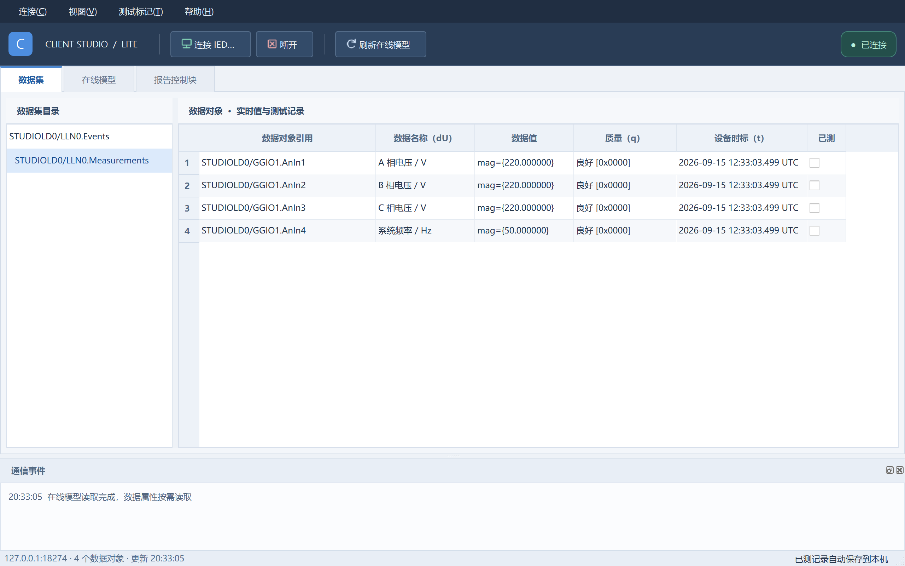
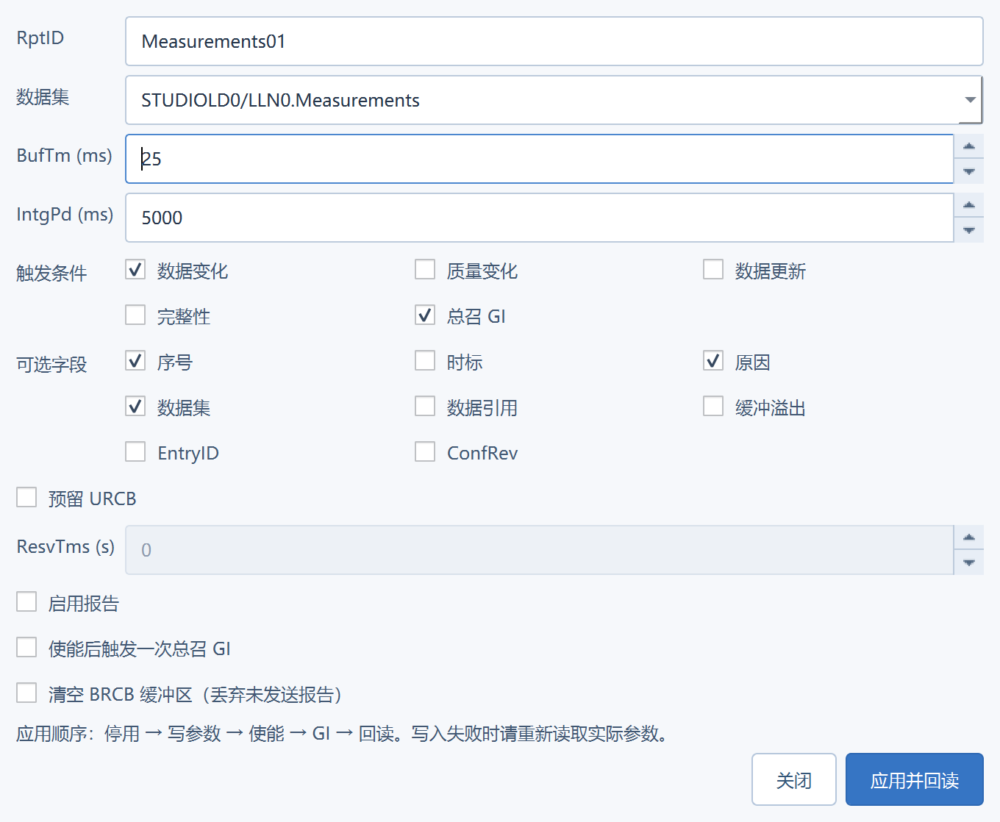

# 0.1.0 验证记录（2026-09-15）

## 已完成

Qt 5.15.2 / MinGW 8.1 x64 Release 构建成功。QtTest 最终结果：7 passed，0 failed，0 skipped（包含初始化/清理项），3773 ms。

真实通信对象为测试脚本独立启动的 Service Studio 本地服务，地址 127.0.0.1:18274；没有操作现场设备。

- LD/LN、按需 DO、数据集及 RCB 发现。
- Measurements 数据集的四个对象，中文 dU、主值、质量、设备 UTC 时标。
- RCB 参数修改、BufTm 回读为 25 ms、报告使能、GI 报告接收及停用。
- SPCSO1 直接控制与状态回读。
- SPCSO2 SBO 增强安全：选择、执行、命令终结回调。
- 原生数据集 UI 自动刷新：另一个会话改变服务端值，当前窗口更新；已测标记保持。
- 已测记录重新创建模型后仍可读取，不同设备地址隔离。
- 空目录返回值处理、2 万行虚拟数据模型更新。
- 实际报告设置/遥控对话框创建与截图。

2 万行数据模型刷新约 14 ms。仅衡量模型赋值和数据变更通知，不包括绘制全表、网络读取和现场设备性能。

## 便携包验证

启动时 PATH 只保留 Windows 系统目录；验证 Qt、平台插件、编译器运行库都从便携包加载。应用直接依赖 Qt Core/Gui/Widgets、MinGW 运行库和 Windows 系统 DLL；不依赖 Electron、gRPC、WinPcap。

最终包 `IEC61850-Client-Lite-0.1.0-Win7-x64.zip`：11,971,116 字节（约 11.4 MiB）。

SHA-256：`E0A650387850CF71EF00AEECD01C67EB15855FF1D2DFF741118CF9EA48E22E83`

最终便携包单次空闲启动测量：308 ms 进入输入空闲状态，1.5 秒后工作集 23.5 MiB、私有内存 7.2 MiB。早先一次测量工作集 33.4 MiB，说明系统状态和测量时机有影响。这些是开发机上未连接窗口的测量，不是 Win7 / 4 GB 验收，也不是大模型稳态内存承诺。

PE 子系统版本已检查为 6.1。尚未完成真实 Windows 7 SP1、4 GB 机器上的运行验收，以及不同厂家 IED 兼容性与长时间稳定性测试。结构型 APC 控制值暂不支持；报告只触发当前值刷新，不作为逐事件历史回放。

## 实际运行截图

